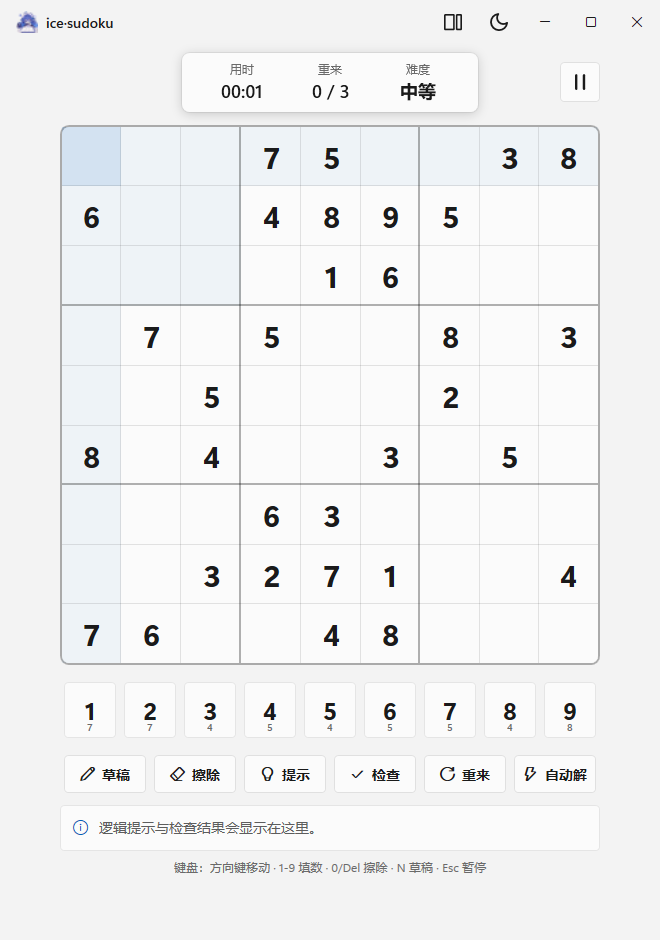
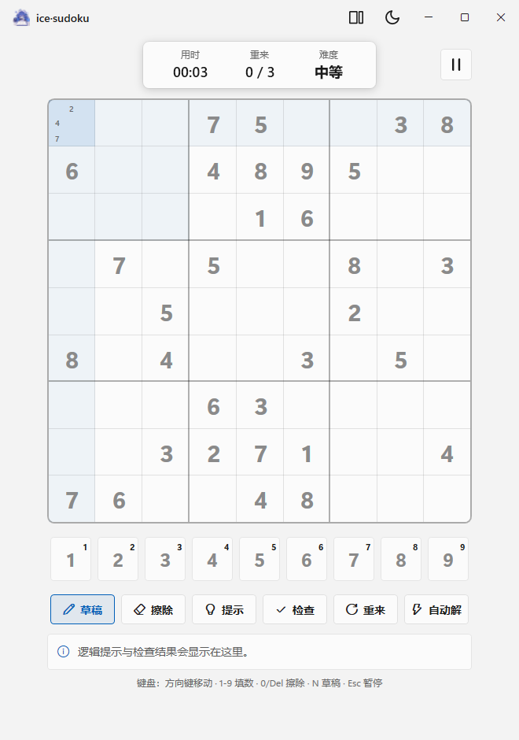
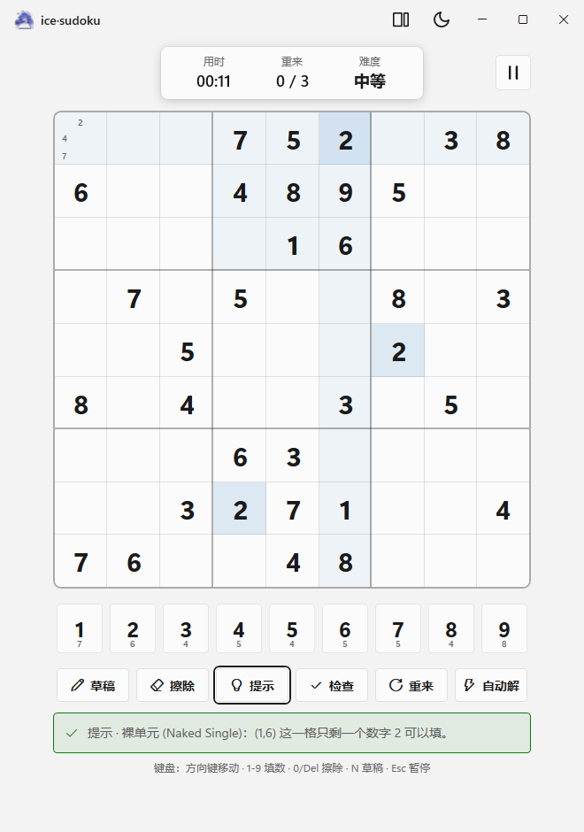
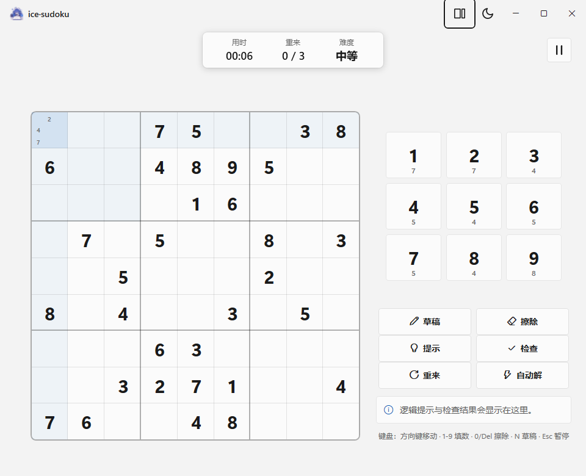
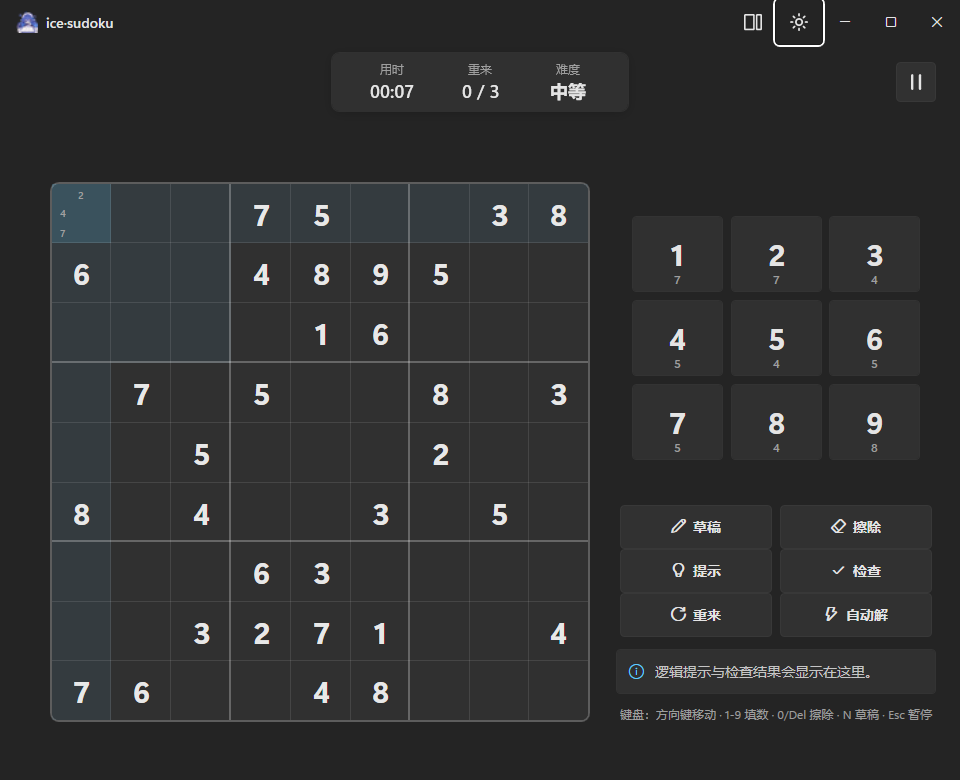

# ice·sudoku 原生绿色版（WPF / WinUI Fluent）


Windows 原生离线数独 · Fluent / WinUI 外观 · 自包含单文件 · HY-pt 维护

> 本仓库 fork 自上游 ice·sudoku。`native-wpf` 分支（默认分支）是 Windows 原生绿色版；`master` 分支保留上游原样内容。

## 界面预览

启动页与游戏过程截图（浅色 / 深色、竖版 / 横版、草稿与提示条）：

| 启动页 | 对局（竖版） |
| --- | --- |
|  |  |
| **草稿模式**（候选小数字） | **提示条 InfoBar** |
|  |  |
| **横版布局（浅色）** | **横版布局（深色）** |
|  |  |

## 来龙去脉

1. **上游 ice·sudoku** —— [tropicalwzc/ice_sudoku.github.io](https://github.com/tropicalwzc/ice_sudoku.github.io)（MIT 许可，作者 tropicalwzc）。覆盖 iOS / macOS / Windows / Ubuntu 的专业数独程序，支持逻辑分步求解与 ResNet34 扫描识别；Windows 官方版止于 2.2.1。
2. **网页绿色版** —— 以 upstream ice·sudoku 为起点，先做了一个浏览器打开、双击即玩的离线网页绿色版（免安装、免联网），供日常使用。
3. **原生重写** —— 为了更贴近 Windows 原生体验（Fluent / WinUI 外观、沉浸式标题栏、明暗主题、单文件离线），用 WPF（.NET 10）完全重写：数独引擎（生成、唯一解校验、逻辑分步求解与提示）、界面与主题均为本分支独立实现，不含上游二进制或代码；延续其名称与玩法脉络，版本号接在上游 Windows 版之后（2.2.1 → 2.3 起）。
4. **版本演进**
   - **2.3**：原生重写首版（引擎、棋盘、数字盘、提示 / 自动解、明暗主题）
   - **2.4**：启动页与应用图标、暂停页与难度调整、沉浸式标题栏、Win11 圆角与工作区最大化、启动图 / 图标抠除白底
   - **2.5**：标题栏横竖布局切换、草稿模式、三次错误改为三次重来、取消即时判错与答案泄露
   - **2.5.1**：两种布局统计框顶部居中、暂停按钮右上角；草稿视觉重做（棋盘数字含预设全部变灰、数字键右上角同数字可用角标）
   - **2.5.2**：横版右侧面板与棋盘等高对齐、数字键改为近方形大按键
   - **2.6.0**：按 WinUI Gallery 逐项对齐——Segoe Fluent Icons 图标、双层焦点框、按下 / 禁用态、InfoBar 提示条、字阶与 4px 间距、卡片阴影与切页动效、读屏名称、高对比度主题；背景默认柔和纯色，`--mica` 可选云母材质
   - **2.6.1**：横版数字盘改为紧凑 3×3 键位并放大键内数字；草稿大数字进一步淡化、可用角标加粗放大；暂停按钮改为圆角矩形
5. **关于配图** —— 启动页与本 README 的 chibi 插画为 AI 生成后经抠图（透明底）处理；同一张图也用于应用图标（`native/Assets/app.ico`）。

感谢上游作者 tropicalwzc 的 ice·sudoku 与 MIT 许可。

## 功能（v2.6.1）

- 自包含单文件 exe，内置 .NET 运行时，解压双击即玩，免安装 / 免联网 / 免浏览器
- 启动页：开始游戏 / 退出游戏
- 横竖两种布局：竖版棋盘在上、数字盘在下；横版棋盘在左、数字盘在右（3×3 紧凑键位、大号数字）；标题栏按钮一键互换
- 统计框（用时 / 重来 / 难度）两种布局均顶部居中，暂停按钮为右上角圆角矩形
- 草稿模式：空格记候选小数字；棋盘所有数字（含预设）变铅笔灰；数字键大数字变淡、右上角出现加粗的正常色同数字角标表示仍可用
- 非草稿模式：数字键下方小数字 = 剩余可填数量，填完自动置灰
- 不即时判错、不泄露答案；冲突仅标红可见重复；盘面填满且无冲突即完成
- 「重来」清空全部自填数字与草稿，每局 3 次机会
- 「提示」给出逻辑可推导的一步；「自动解」直接展示答案
- 暂停页调整难度（简单 / 中等 / 困难 / 专家），开始新游戏时生效
- 明暗主题切换；Win11 圆角窗口；最大化精确铺满工作区
- WinUI 对齐细节：Segoe Fluent Icons 图标、双层键盘焦点框、按钮按下 / 禁用态、悬停 Tooltip、InfoBar 提示条、统一字阶与 4px 间距、卡片阴影、切页与浮层过渡动画
- 读屏名称覆盖棋盘格、数字键与图标按钮；跟随系统高对比度主题
- 背景默认柔和纯色；`--mica` 在支持的设备上尝试 Windows 11 云母材质（不可用时自动保持纯色可读）

## 下载与运行

- 最新发布：[v2.6.1](https://github.com/HY-pt/ice-sudoku-native/releases/tag/v2.6.1)（资产 `ice_sudoku_v2.6.1_win-x64.exe`）
- 系统要求：Windows 10 / 11 64 位
- 双击运行；首次若被 SmartScreen 拦截，选择「仍要运行」（本地自编译绿色软件，未签名）
- 可选启动参数：`--mica` 尝试云母材质；`--solid` 强制纯色背景

## 操作

| 动作 | 按键 |
| --- | --- |
| 选中格子 | 鼠标点击 / 方向键 |
| 填数 | 1-9 或数字键 |
| 擦除 | 0 / Del / Backspace |
| 草稿模式 | N 或「✏ 草稿」 |
| 暂停 / 继续 | Esc 或暂停按钮 |
| 横竖布局 | 标题栏切换按钮 |
| 明暗主题 | 标题栏月亮 / 太阳 |

## 从源码构建

需要 .NET SDK 10（Windows）：

```powershell
dotnet publish native/ice_sudoku_wpf.csproj -c Release -r win-x64 --self-contained true -p:PublishSingleFile=true -p:IncludeNativeLibrariesForSelfExtract=true -p:EnableCompressionInSingleFile=true
```

产物为自包含单文件 exe。

## 分支与许可

- `master`：上游原样内容（fork 保留，未改动）
- `native-wpf`：本原生绿色版（默认分支）
- 许可：沿用上游 MIT（见 LICENSE）；本分支代码与文档同以 MIT 发布，版权 HY-pt
- 启动页 / 图标图：AI 生成 + 人工抠图，仅用于本项目

— HY-pt